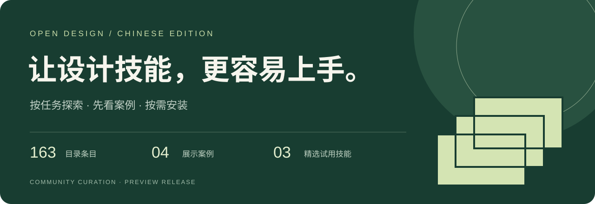
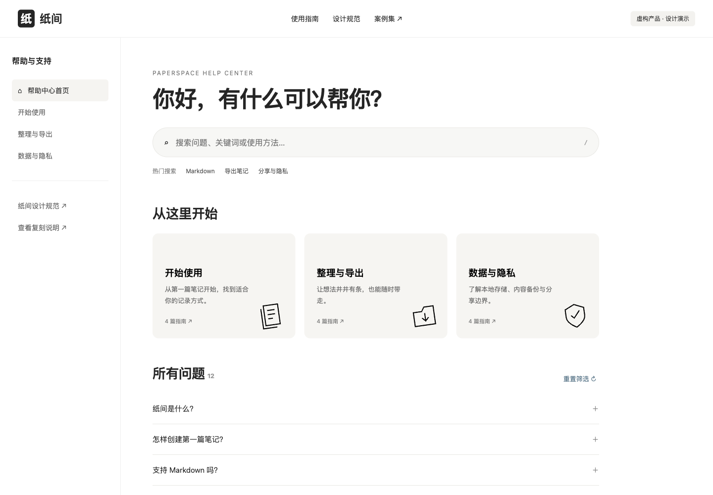
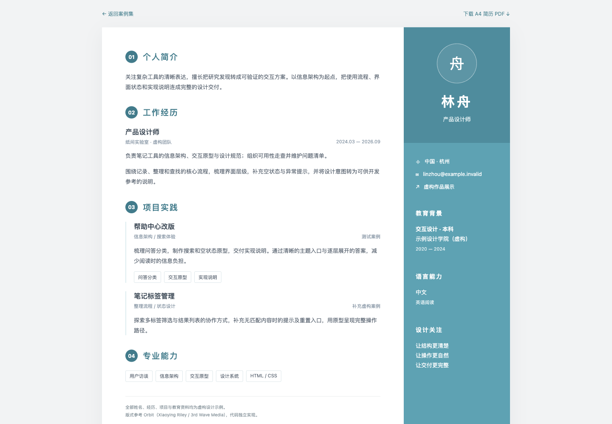
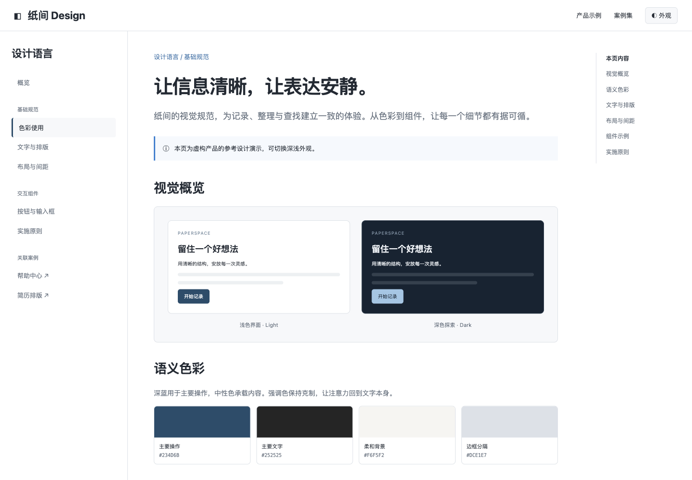

<p align="center"></p>

<p align="center">
  <a href="https://guanche-lucent.github.io/open-design-skills-zh/"><b>在线体验案例</b></a> ·
  <a href="https://github.com/guanche-lucent/open-design-skills-zh/releases/tag/v0.1.0-preview.2"><b>下载精选试用包</b></a> ·
  <a href="CATALOG.md"><b>浏览完整目录</b></a>
</p>

# OpenDesign 设计技能中文导航

从“我想做什么”出发，找到合适的设计技能，先看输出，再决定是否安装。

基于 OpenDesign `open-design-v0.24.1` 整理的社区导航，保留上游正文与许可。不是官方项目，也不是全量汉化或全量可运行的承诺。

<!-- stats:start -->
共 **163 项**：**77 项附带正文**、**41 项仅简介**、**45 项仅外链**。其中 **3 项完成当前会话显式读取试用**；其余未运行验证。自动发现与跨平台执行另行验证。
<!-- stats:end -->

## 先看作品

<table>
<tr><td width="50%"><a href="https://guanche-lucent.github.io/open-design-skills-zh/reference-replicas/help.html"></a><br><b>01 / 纸间帮助中心</b><br>搜索、主题分类与折叠问答。参考增强展示。</td><td width="50%"><a href="https://guanche-lucent.github.io/open-design-skills-zh/reference-replicas/resume.html"></a><br><b>02 / 产品设计师简历</b><br>双栏排版与 A4 PDF。全部简历资料为虚构。</td></tr>
<tr><td><a href="https://guanche-lucent.github.io/open-design-skills-zh/reference-replicas/design.html"></a><br><b>03 / 纸间设计规范</b><br>色彩、文字与组件的可视化规范。参考增强展示。</td><td><a href="https://guanche-lucent.github.io/open-design-skills-zh/web-clone-tokyo/index.html"></a><br><b>04 / Web Clone 东京动画</b><br>OpenDesign 既有作品，含原网站对比入口与素材署名。</td></tr>
</table>

前三项展示经过参考设计增强，不代表原技能默认输出。第四项已核对迁入后的场景加载，不等同于技能安装与全流程复现测试。[查看实测范围](docs/validation-results.md)

## 选一个任务开始

| 你想做什么 | 入口 |
|---|---|
| 做网页、落地页或界面 | [网页与界面](docs/scenarios.md#web) |
| 优化已有页面 | [页面优化](docs/scenarios.md#polish) |
| 做卡片、海报或长文排版 | [图文内容](docs/scenarios.md#content) |
| 做汇报或演示 | [演示文稿](docs/scenarios.md#slides) |
| 整理设计规范 | [设计系统](docs/scenarios.md#system) |
| 找更多能力 | [完整目录](CATALOG.md) |

## 安装第一个技能

下载并解压 [精选试用包](https://github.com/guanche-lucent/open-design-skills-zh/releases/tag/v0.1.0-preview.2)，在解压目录运行：

```bash
mkdir -p ../my-design-project
python3 scripts/install.py install --skill faq-page --project ../my-design-project --agent codex
```

然后在试用项目中让 Agent **明确读取** `.agents/skills/faq-page/SKILL.md`，并提供自己的问答与设计要求。

| 包含的技能 | 主要输出 |
|---|---|
| `faq-page` | 可搜索、可分类的 FAQ 页面 |
| `resume-modern` | 简历 HTML；单页效果需按内容检查 |
| `reference-design-contract` | 设计规范、决策记录与实现交接 |

需要 Python 3.9+ 和可读取文件的 Agent。只验证了当前 Codex 会话显式读取执行；自动发现、独立新会话与 Claude 实际执行仍待验证。Web Clone 当前只作为案例展示，不在精选安装包中。

[完整安装说明](docs/installation.md) · [兼容性](docs/compatibility.md) · [试用证据](docs/validation-results.md)

## 本地查看案例

完整仓库下载后运行 `python3 scripts/preview_examples.py`，打开终端中的链接。3D 案例需要 HTTP 服务，不能只复制单个 HTML。

## 来源、许可与维护

技能来自 [nexu-io/open-design](https://github.com/nexu-io/open-design)。本轮核对了精选三项的上游文件，其余沿用原包声明。各技能、示例及第三方素材按各自许可分发，中文整理不改变原许可。东京模型来自 Glen Fox，保留 CC BY 4.0 署名。

[LICENSE](LICENSE) · [NOTICE](NOTICE) · [东京模型署名](examples/web-clone-tokyo/ATTRIBUTION.md) · [参考设计来源](examples/reference-replicas/README.md)

[维护指南](docs/maintenance.md) · [资产核查](docs/audit/asset-audit.md) · [发布进度](docs/status.md) · [更新记录](CHANGELOG.md)

发现缺失依赖、断链或使用问题，请通过 Issues 附上技能名称、运行环境与复现步骤。
