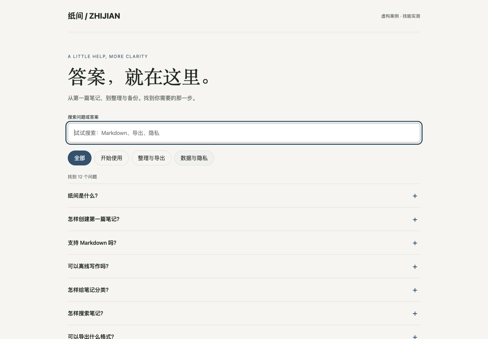
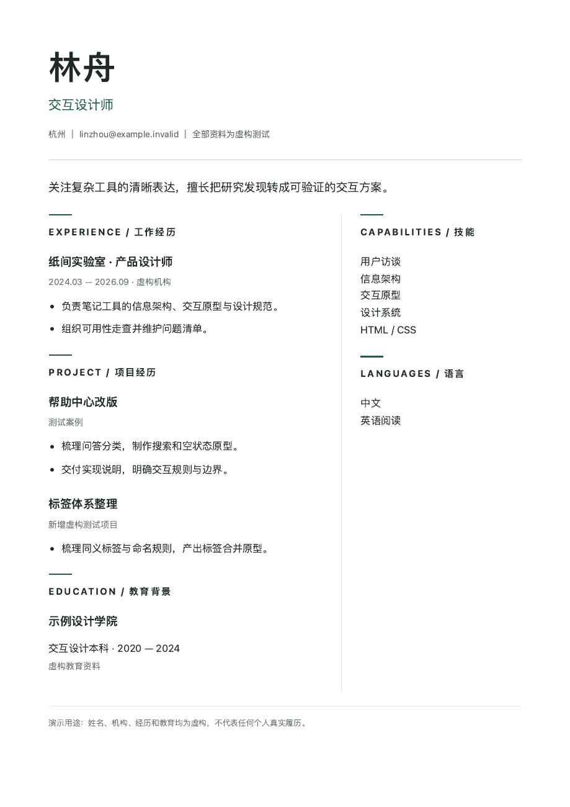

# 首轮运行与安装验证

日期：2026-10-12。状态：**试用预览，非全面兼容认证**。

## 测试方式与边界

执行者为当前 Codex 对话，显式读取隔离项目安装目录内的 SKILL.md，再按固定输入生成文件。没有另起独立模型会话，模型具体版本未独立读取；没有测试自动发现、斜杠命令、Claude Code 实际执行或多次重复成功率。此结果不能用于证明某个模型或技能优于其他方案。

环境：macOS 26.4；安装器 Python 3.9.6；Ego Lite Chromium 152。项目安装位置 .agents/skills；未修改全局技能。测试没有调用付费图像/音视频 API，不代表 Agent 本身免费。

## 本轮为什么选择这三项

从正文条目出发，优先选本地文件足够、无需付费 API、能检查明确结果的任务，覆盖规范文档、页面交互和打印布局。FAQ 提及注入 DESIGN.md，本次明确提供该文件，不能把它描述成不需要输入约束。简历是模板型技能，功能较窄；设计合约是上游 skill 工作流。

其他条目继续保留导航，不凭数量列入安装包。当前选择是测试覆盖考虑，不是质量排名。

## 结果

| 技能 | 固定任务 | 修改任务 | 实际检查 |
|---|---|---|---|
| reference-design-contract | 为虚构笔记产品建立规范和交接 | 改强调色并增加空结果重置规则 | 三个文件、九章结构、证据边界与修改同步通过人工/结构检查 |
| faq-page | 12 问答、3 分类、搜索和折叠 | 改色并增加清除筛选 | 搜索问题/答案、大写小写、分类组合、零结果、键盘、390/1440px 布局通过 |
| resume-modern | 虚构 A4 简历 | 改职位并新增项目 | HTML 无横向溢出；第一次修改后 PDF 两页，修复间距后 A4 单页，正文不删减 |

## 查看产物

- 设计规范：[输入](../examples/validation-20261012/reference-design-contract/input.md) · [DESIGN.md](../examples/validation-20261012/reference-design-contract/DESIGN.md) · [决策记录](../examples/validation-20261012/reference-design-contract/design-contract.md) · [交接](../examples/validation-20261012/reference-design-contract/implementation-handoff.md)
- FAQ：[输入](../examples/validation-20261012/faq-page/input.json) · [页面](../examples/validation-20261012/faq-page/index.html) · [修改前结果](../examples/validation-20261012/faq-page/browser-before.json) · [修改后结果](../examples/validation-20261012/faq-page/browser-after.json)
- 简历：[输入](../examples/validation-20261012/resume-modern/input.md) · [页面](../examples/validation-20261012/resume-modern/index.html) · [最终 PDF](../examples/validation-20261012/resume-modern/resume.pdf) · [失败与修复](../examples/validation-20261012/resume-modern/repair.md)

HTML 在本地浏览器打开；GitHub 文件页面展示源码，不等于在线运行。所有人物、机构和产品均为虚构测试。

### FAQ 实测预览

### 简历打印实测预览

## 安装器验证

7 项隔离目录测试通过：安装/更新/卸载保留项目产物；拒绝覆盖非本工具目录；用户修改后拒绝更新或卸载；拒绝未知和路径穿越 ID；拒绝符号链接目标；Claude 目录布局正确；新增用户文件不被卸载。测试代码见 [test_install.py](../tests/test_install.py)。

自动化安装不是 Agent 自动发现验证。显式读取方式已走通，完整自动发现仍需在新的目标工具会话确认。

## 来源核对

三项共 8 个技能文件与固定上游提交 `89e64d813bb1c7a11519b3f668f011f7017637d7` 字节一致；目录许可声明和根许可已取回。详见 [来源记录](audit/upstream/selected-source-check.json) 和 [逐文件比对](audit/upstream/selected-resources.json)。这不覆盖另外 160 项的在线复核。

## 原始失败记录

- 浏览器首次键盘测试选择器命中 12 项，测试脚本改为首项唯一选择器后重跑；不是页面功能失败。
- 简历新增项目后溢出两页，保留 after-overflow.html/pdf，调整间距并重新渲染检查。
- 没有替换上游示例冒充实测；before.html 是本轮生成的初始版本。
